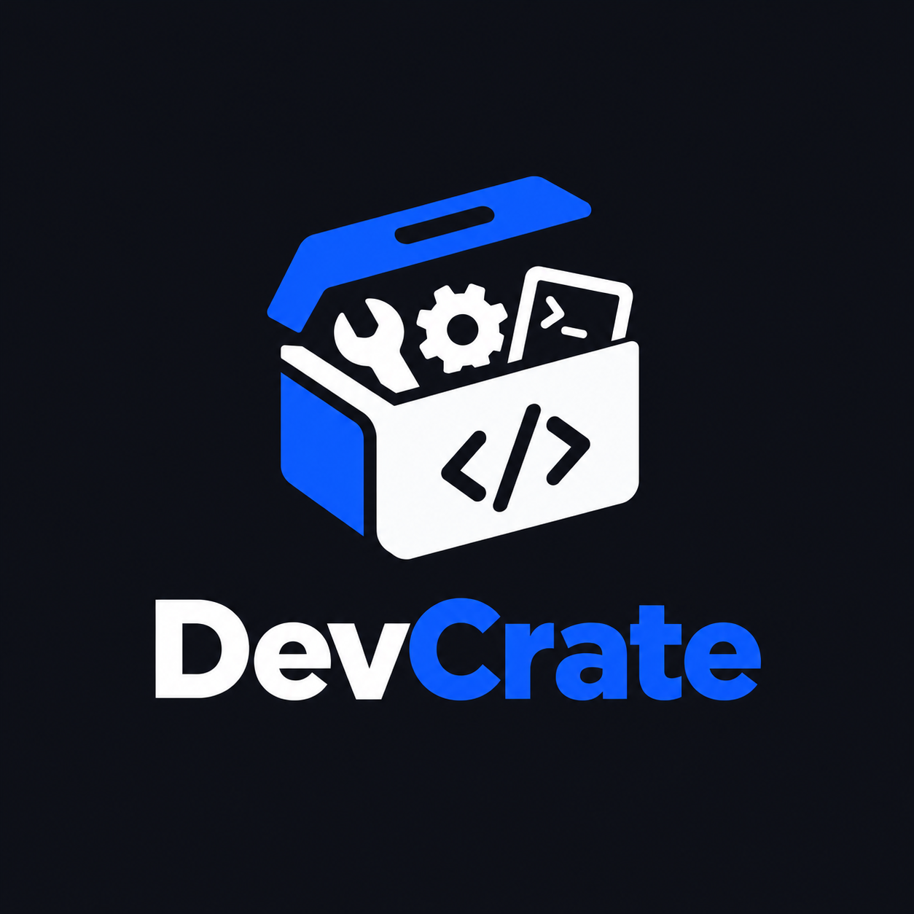
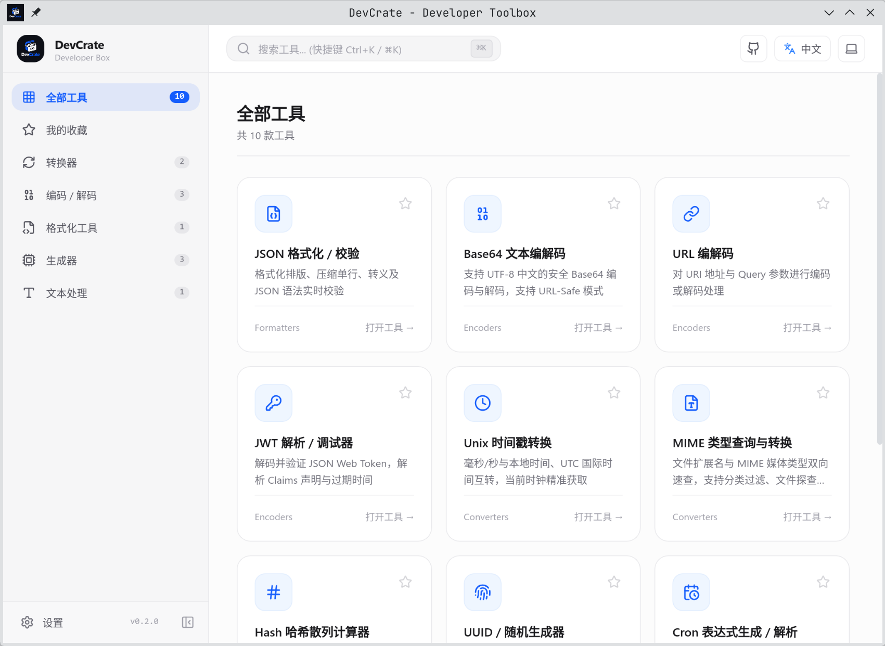
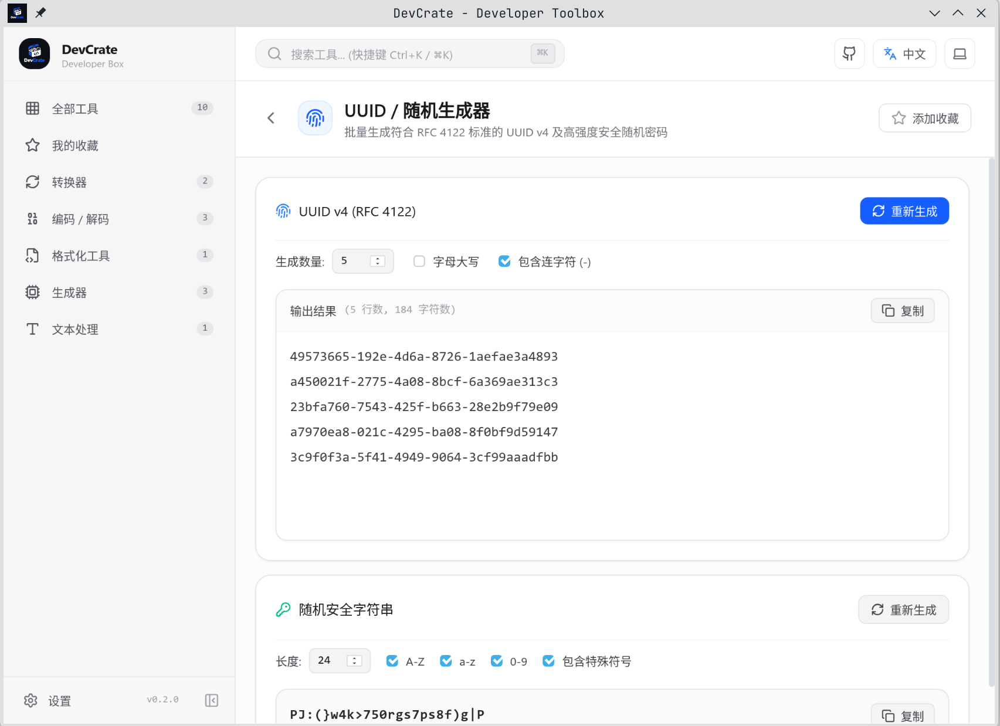
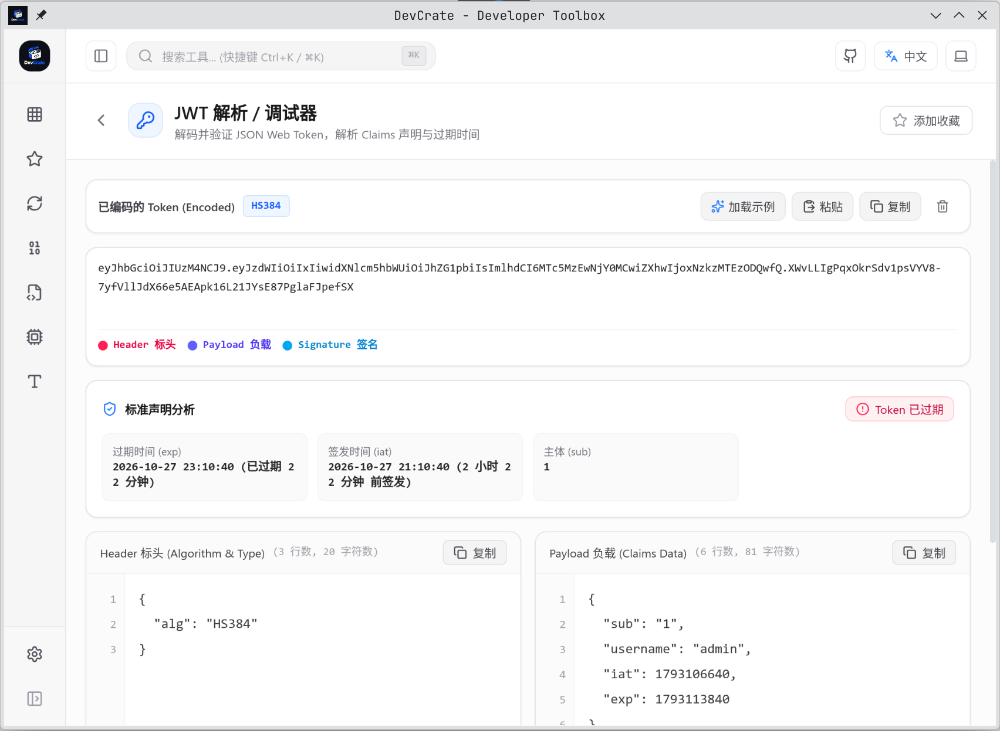
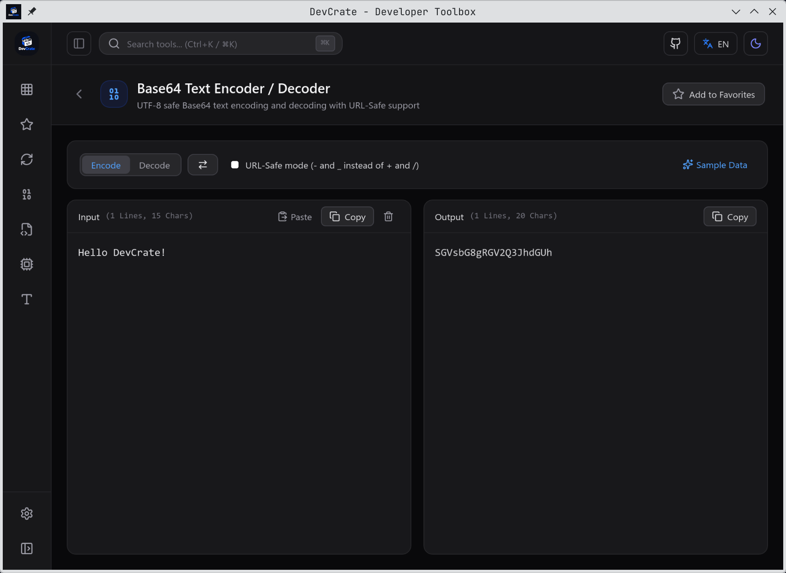

# DevCrate

<div align="center">
  
  <p>Modern cross-platform offline developer toolbox built with Tauri 2 and Vue 3.</p>
  <p>All tools run 100% locally with zero network dependencies.</p>
  <p>
    <a href="./README.md">简体中文</a> | English
  </p>
</div>

## Screenshots

|  |  |
| ------------------------- | ------------------------- |
|  |  |

## Built-in Tools

### Formatters
- **JSON Formatter & Validator**: Indentation, minification, escaping, tree view, and smart syntax repair

### Encoders & Decoders
- **JWT Parser**: Token breakdown, claims inspection, and local HMAC signature verification
- **Base64 Encoder**: Full UTF-8 support and URL-Safe mode
- **URL Encoder**: Full URI and component mode with real-time query parameter parsing

### Converters
- **Chmod Calculator**: Bi-directional conversion between octal (0755), symbolic (-rwxr-xr-x), and interactive checkboxes
- **MIME Types Lookup**: Bi-directional lookup, file-based detection, and HTTP header generation
- **Unix Timestamp**: Real-time clock, seconds/milliseconds to Local/UTC/ISO 8601 conversion

### Generators
- **Cron Expression Generator & Parser**: Human-readable schedule translation, next run forecast, and visual builder
- **Hash Generator**: Hardware-accelerated MD5, SHA-1, SHA-256, SHA-384, and SHA-512
- **UUID & Password Generator**: Batch UUID v4, customizable random passwords and tokens

### Text Utilities
- **Text Inspector & Case Converter**: Character/word/line/byte statistics and programming casing conversions

### Network
- **HAR File Viewer**: Deep visual analysis of HTTP archive logs (.har), featuring waterfall timeline, headers, cookies, payload, response preview, and cURL export

## Installation

### Arch Linux (AUR)

```bash
yay -S devcrate
# or
paru -S devcrate
```

### macOS (Homebrew)

```bash
brew install --cask LongYinStudio/tap/devcrate
```

Or download `.dmg` installer from [Releases](https://github.com/LongYinStudio/DevCrate/releases/latest).

### Other Platforms

Download pre-built binaries from [Releases](https://github.com/LongYinStudio/DevCrate/releases/latest):

- Windows: `.exe`
- Linux: `.deb` / `.rpm`

## License

MIT
