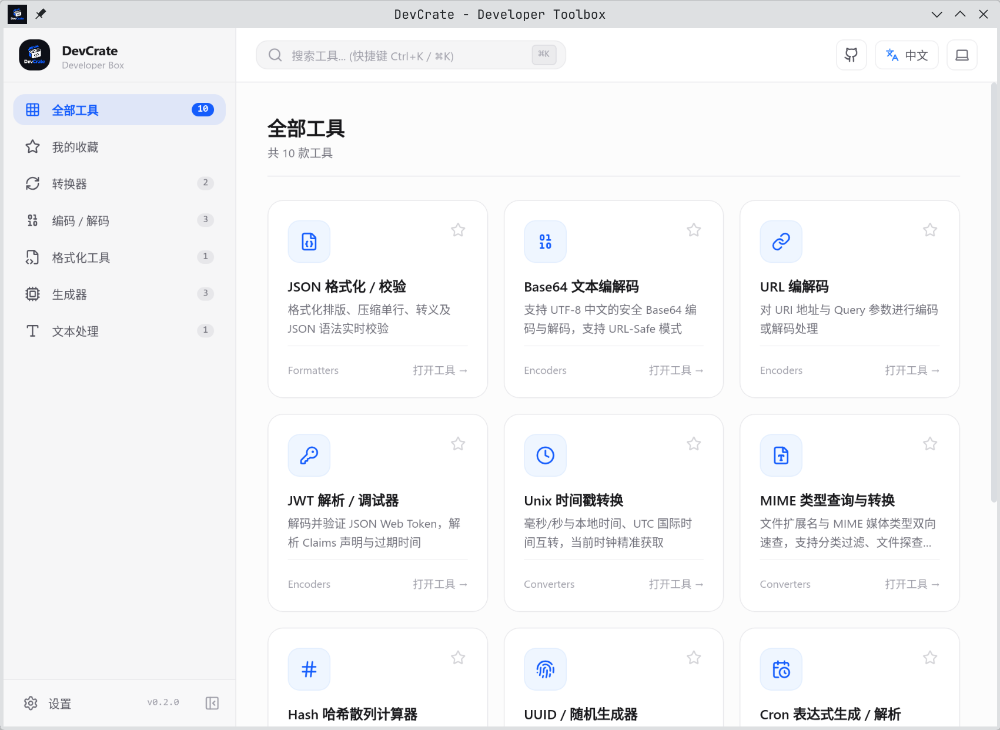
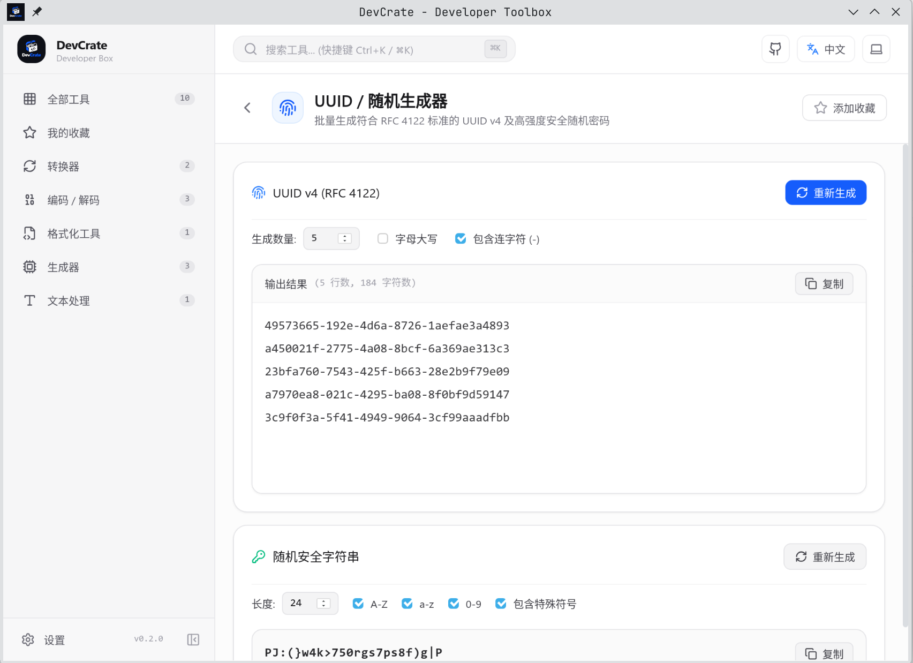
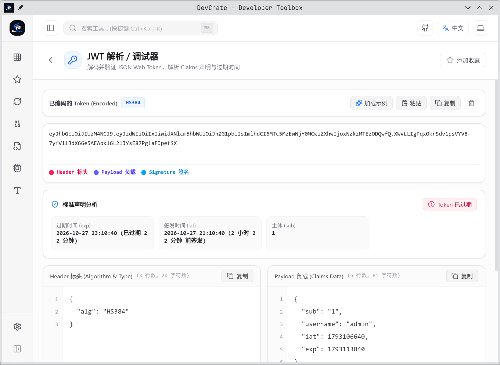
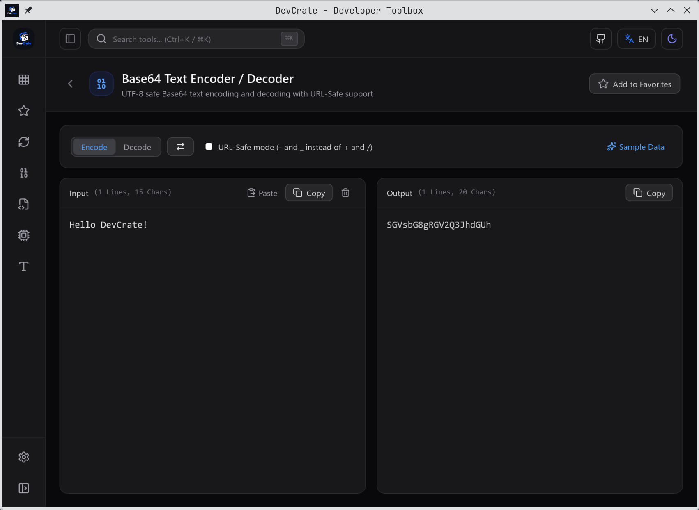

# DevCrate

<div align="center">
  
  <p>现代跨平台本地离线开发者工具箱，基于 Tauri 2 与 Vue 3 构建。</p>
  <p>所有工具纯本地运行，零网络依赖，保障数据隐私安全。</p>
  <p>
    简体中文 | <a href="./README.en-US.md">English</a>
  </p>
</div>

## 截图

|  |  |
| ------------------------- | ------------------------- |
|  |  |

## 内置工具

### 格式化工具
- **JSON 格式化 / 校验**：缩进美化、单行压缩、转义处理、树形视图与语法智能修复
- **SVG 编辑器与格式化**：实时矢量画布预览、XML 代码美化与极速压缩、设计软件垃圾元数据清理、尺寸/色彩/几何微调、位图高倍导出及 React / Vue / Data URI 多端代码生成

### 编码与解码
- **JWT 解析器**：Token 结构反解、标准声明过期分析与本地 HMAC 签名校验
- **Base64 编解码**：支持 UTF-8 字符集与 URL-Safe 模式
- **URL 编解码**：支持完整 URI 与组件参数模式，Query 参数实时解析

### 转换器
- **字体子集化 / 字体裁剪**：基于 HarfBuzz WASM 本地裁剪 TTF / OTF / WOFF / WOFF2 / TTC 字体，支持文本与源码字符提取、Unicode 范围与高频预设、缺失字形检测、字形表点选、可变字体轴固化/缩窄、OpenType 特性与 Hinting 优化、裁剪前后实时渲染对比及 `@font-face` / `unicode-range` / Base64 导出
- **配置文件格式转换器**：支持 JSON / JSONC、YAML、TOML、XML、INI、.env 与 .properties 之间的双向互转，具备输入格式自动识别、嵌套键展开/扁平化、类型推断、键名排序、语法错误行定位、文件导入导出及交互式树形结构预览
- **图片 ↔ Base64 转换器**：图片与 Base64 / Data URI 双向无损互转，支持拖拽上传、剪贴板直接贴图、WebP/JPEG 重编码压缩、HTML/CSS/Markdown 片段生成及魔数自动识别还原下载
- **文本 / 二进制转换器**：支持 UTF-8、ASCII、UTF-16 编码的文本与二进制比特流双向实时互转，支持自定义分隔符、0b 前缀、8 位补零及逐字符字节对照透视
- **进制转换器**：支持 2 ~ 64 任意进制互转与 BigInt 大数精度，提供二进制交互位图矩阵、有符号/无符号整型与大小端序拆解
- **Chmod 权限计算器**：八进制 (0755)、符号表示法 (-rwxr-xr-x) 与复选框矩阵即时互转，支持特殊权限位与命令生成
- **MIME 类型查询**：文件扩展名与 MIME 媒体类型双向检索，支持文件推断与 HTTP 标头复制
- **Unix 时间戳转换**：实时时钟、秒与毫秒时间戳、本地时间与 UTC/ISO 8601 双向换算

### 生成器
- **Systemd `.service` 守护进程单元生成器**：可视化生成 Linux `.service` 文件，配置 `ExecStart`、工作目录、运行用户、`Restart` 策略、环境变量、`After/Requires` 依赖、资源限制与沙箱加固，支持 System / `--user` 作用域、现有 `.service` 导入反解及配套 `systemctl` / `journalctl` 命令生成
- **SSH Config & 端口转发生成器**：可视化编排 `~/.ssh/config` 主机配置、多账号 Git 密钥分流、`ProxyJump` 跳板机链路、`-L/-R/-D` 端口转发与 SOCKS5 隧道、连接多路复用、`Host *` 优先级校验，并同步生成配套 `ssh` / `scp` / `rsync` / `ssh-copy-id` 命令
- **Docker Compose 生成器 & `docker run` 互转**：可视化编排 `compose.yml` 多容器栈，支持 `docker run` CLI 与 Compose 双向互转、常见数据库/中间件服务库、现有 `compose.yml` 导入解析、端口冲突/循环依赖检查及 `.env` 模板导出
- **GitHub Actions 生成器**：可视化编排 CI/CD 工作流，内置 Node.js/Rust/Python/Go/Docker/GitHub Pages/Tauri 等 8 套场景预设，支持触发器、Matrix 矩阵、权限矩阵、Actions 动作库、现有 `.yml` 导入反解及静态环路/权限检查
- **Nginx 配置生成器**：收录 nginx.org 官方全部 1009 条指令与 101 个模块，支持反向代理/HTTPS/负载均衡/SPA/API 网关/Stream 预设、可视化配置树、任意指令搜索添加与上下文校验、现有 `nginx.conf` 导入解析及格式化导出
- **Gitignore 生成器**：涵盖主流编程语言、前端/后端框架、开发工具与操作系统的多技术栈 .gitignore 忽略规则快速生成、智能合并、规则去重与定制导出
- **Cron 表达式生成 / 解析**：自然语言解读、未来执行时间预测与可视化参数构建
- **Hash 计算器**：原生硬件加速计算 MD5、SHA-1、SHA-256、SHA-384、SHA-512
- **UUID / 密码生成器**：批量生成 UUID v4、自定义规则高强度随机密码与 Token

### 文本处理
- **SemVer 版本范围测试器**：测试 npm / Cargo 语义化版本范围表达式（`^` / `~` / `-` / `||`），支持批量版本匹配排序、预发布规则验证、双版本对比与升级风险分析及 Bump 递增计算
- **代码 / 文本对比工具**：基于 Myers Diff 算法提供左右并排、行内统一与标准 Git `.patch` 视图，支持行内词元级差异高亮、未变更代码折叠、空白/大小写/空行忽略、JSON 键排序归一化、变更块跳转及双侧文件拖拽导入
- **HTML 标签去除**：智能剥离标签并提取清晰易读的纯文本，支持块级换行、HTML 实体解码、超链接与图片提取、标签白名单及空白规整
- **正则表达式测试器**：实时语法高亮匹配、捕获组拆解分析、正则文本替换、常用高频规则库及多语言代码生成
- **文本分析与命名风格转换**：字符/词数/行数/字节统计，支持主流编程命名法互转

### 网络工具
- **HTTP 状态码参考**：全面收录 RFC 标准及 Nginx / Cloudflare 扩展 HTTP 状态码，提供高频速查、REST API 选码向导、常见成因、排查方案、可缓存/可重试标识与关联 Header 筛选
- **CIDR / 子网计算器**：IPv4 / IPv6 CIDR 网段拆解、掩码与反掩码换算、32 位网络/主机二进制位图、子网切分及 IP 归属与网段重叠检测
- **WebSocket & SSE 测试器**：支持 WebSocket 全双工消息收发、定时心跳保活、Hex 二进制帧调试，以及支持自定义 Headers 与 GET/POST 的 SSE 事件流与 AI 文本流聚合预览
- **端口扫描与占用排查**：高并发 TCP 端口连通性探测、知名服务识别，本机活跃监听端口排查及占用进程一键释放
- **HAR 文件查看器**：HTTP 抓包归档文件 (.har) 深度可视化分析，支持瀑布流、请求/响应标头、载荷、Cookie、时序耗时与 cURL 生成

## 安装

### Arch Linux (AUR)

```bash
yay -S devcrate
# 或
paru -S devcrate
```

### macOS (Homebrew)

```bash
brew install --cask LongYinStudio/tap/devcrate
```

也可以从 [Releases](https://github.com/LongYinStudio/DevCrate/releases/latest) 下载 `.dmg` 安装包。

### 其他平台

前往 [Releases](https://github.com/LongYinStudio/DevCrate/releases/latest) 下载对应平台的安装包：

- Windows: `.exe`
- Linux: `.deb` / `.rpm`

## License

MIT
